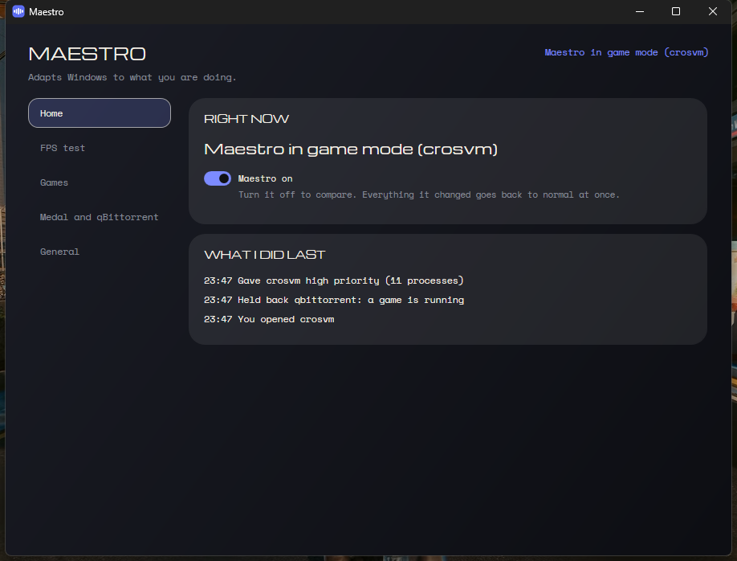
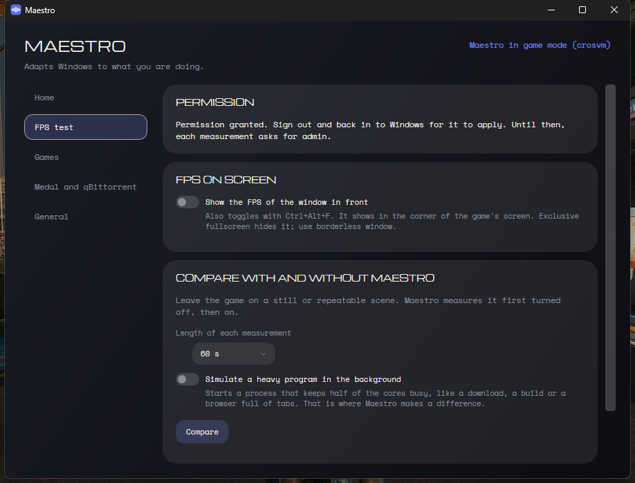

<div align="center">


# Maestro

**Windows tuned to what you are doing, with the FPS to prove it.**<br>
A tray app that gives the game in front the priority, holds back whatever hogs the CPU behind it, and measures your FPS with and without it, so you see the difference instead of taking it on faith.

[](https://github.com/obrenoalvim/maestro/releases/latest/download/Maestro.exe)

[](LICENSE)
[](https://github.com/obrenoalvim/maestro/stargazers)
[](https://github.com/obrenoalvim/maestro/releases/latest)
[](src/Maestro/Maestro.csproj)
[](#faq)

**English** · [Português](README.pt-BR.md)

[Install](#install) · [What it does](#what-it-does) · [The FPS test](#the-fps-test) · [Spotting a game](#how-it-spots-a-game) · [What it never touches](#what-it-never-touches) · [Settings](#settings) · [FAQ](#faq) · [Build](#build)

</div>

---



Maestro sits next to the clock and watches what you are doing. Open a game and it gives the game high priority, slows your torrents and starts Medal to record. Leave something heavy running in the background and it moves it out of the way, then lets go the moment you click its window. Close the game and everything goes back to how it was. It needs no admin rights and sends nothing anywhere.

## Install

1. **Download** [`Maestro.exe`](https://github.com/obrenoalvim/maestro/releases/latest/download/Maestro.exe). It is a single file with everything included, so there is no .NET to install. Windows 10 version 2004 or newer.
2. **Double-click it.** If Windows shows a blue "Windows protected your PC" screen, click **More info**, then **Run anyway**. That screen appears because the file is not code-signed yet.
3. **The window opens** and an icon shows up next to the clock. Maestro starts with Windows from then on and adds itself to the Start menu. Turn startup off on the **General** page.

To remove it: pick **Exit** in the tray menu, then delete `Maestro.exe` and the folders `%APPDATA%\Maestro` and `%LOCALAPPDATA%\Maestro`.

## What it does

**When you open a game**
- The game gets high priority.
- Torrent clients (anything in `SlowDuringGames`) get held back, and qBittorrent's alternative speed limit turns on if its Web UI is on.
- Medal starts hidden so it can record.

**When the game closes**, all of that is undone. Medal closes a few minutes later, unless you are using its window.

**All the time**
- A background program that stays above 15% of the CPU for 6 seconds (8% while a game runs) goes to below normal priority, efficiency mode and low disk priority. On hybrid CPUs that moves it to the E-cores.
- It goes back to normal when it calms down, or the instant you bring its window to the front.
- A program reading or writing more than 20 MB/s (a copy, an install, a download landing on disk) gets above normal priority while no game runs.

Every change is written to a journal first. Pausing, exiting or a crash followed by the next start puts every process back as it was.

## The FPS test



- **FPS on screen.** Turn it on in the app, the tray menu or with `Ctrl+Alt+F`. It shows the FPS and the 1% low of the window in front, in the corner of its screen.
- **Compare with and without Maestro.** Leave the game on a still or repeatable scene and click **Compare**. Maestro measures it turned off, then turned on, and shows average FPS, 1% low and worst frame time side by side. Past comparisons stay listed.
- **Simulate a heavy program.** Background load is where Maestro helps, so this switch starts a process that keeps half of the cores busy during both measurements, like a build or a browser full of tabs.

With nothing heavy in the background the difference is small, because Windows already favors the window in front. Expect it in the 1% lows when something competes for the CPU. Differences under 2% are normal run-to-run noise.

Frames are read by [PresentMon](https://github.com/GameTechDev/PresentMon), Intel's open source frame meter, downloaded from its GitHub release the first time you use it and checked by SHA-256. Windows only lets an app read another program's frames with admin rights or from an account in the **Performance Log Users** group, so the first time Maestro offers **Allow once**: one admin prompt, then sign out and back in, and it never asks again. Until then each measurement asks for admin.

## How it spots a game

There is no list of games to keep up to date. Maestro follows Windows:
- the `GameBarPresenceWriter` process, which the Game Bar runs while a game is on;
- the games Windows has already seen, in `HKCU\System\GameConfigStore`;
- the ones you marked by hand in the Game Bar (`Win+G`, "Remember this is a game");
- anything you add to `ExtraGames`.

## What it never touches

The window in front, system processes, audio, known anti-cheats, and the `NeverRestrain` list (Explorer, Discord, OBS, Medal and a few input tools by default). If Windows refuses a change, Maestro leaves that process alone.

## Settings

Everything is on the window's pages and saved to `%APPDATA%\Maestro\maestro.json`, which reloads when you save it by hand. If the file has an error, Maestro keeps the last version that worked and says so in the tray menu.

| Key | What for |
| --- | --- |
| `ExtraGames` | process names that count as games even if Windows does not know them |
| `NeverRestrain` | processes it never holds back |
| `SlowDuringGames` | processes held back while a game runs |
| `Medal` | `Manage`, `Path` and `CloseAfterMinutes` |
| `QBittorrentWebUi` | qBittorrent Web UI address, `127.0.0.1` only |
| `Language` | `auto`, `en` or `pt` |
| `CheckUpdates` | ask GitHub for a newer version every few hours |
| `ShowFps` | FPS overlay on at startup |

The history of what it did is in `%LOCALAPPDATA%\Maestro\logs`, kept for seven days.

## FAQ

**Does it need admin rights?** No. The only admin prompt is the optional one-time permission for the FPS meter.

**Will an anti-cheat mind?** Maestro changes priorities through the same Windows calls Task Manager uses. If a game's process refuses, it gives up on that process. Anti-cheat services are on the never-touch list.

**Does the overlay work in exclusive fullscreen?** No, exclusive fullscreen draws over every window. Use borderless window mode. The comparison still measures in exclusive fullscreen.

**How do I undo everything?** Turn **Maestro on** off on the Home page, pick **Pause** in the tray menu, or exit. Everything it changed goes back right away.

**Does it phone home?** No telemetry. It only goes online to download PresentMon when you turn the FPS meter on and, if you leave the option on, to ask GitHub whether a new version is out. It never downloads or installs an update by itself.

**How is this different from Process Lasso?** Maestro is free and open source, knows when you are gaming without a list, takes care of Medal and qBittorrent, and measures the result instead of asking you to trust it.

## Build

You need the .NET 10 SDK.

```powershell
dotnet test
dotnet publish src/Maestro/Maestro.csproj -c Release -r win-x64 --self-contained true -p:PublishSingleFile=true -p:EnableCompressionInSingleFile=true -p:IncludeNativeLibrariesForSelfExtract=true -o publish
```

`Maestro.exe --sair` closes a running instance cleanly, which helps when replacing the file.

## Credits

Ideas from [GameModeExecutor](https://github.com/Geeooff/GameModeExecutor) (MIT), [GameShift](https://github.com/lhceist41/GameShift) (MIT), [Process Governor](https://github.com/SystemXFiles/process-governor) (GPL), [AutoActions](https://github.com/Codectory/AutoActions) (GPL) and [Hook](https://github.com/spddl/Hook). No code from them was copied. FPS data comes from [PresentMon](https://github.com/GameTechDev/PresentMon) (MIT), downloaded at runtime. The interface uses the Michroma and Space Mono fonts (SIL Open Font License).

## License

[MIT](LICENSE)
