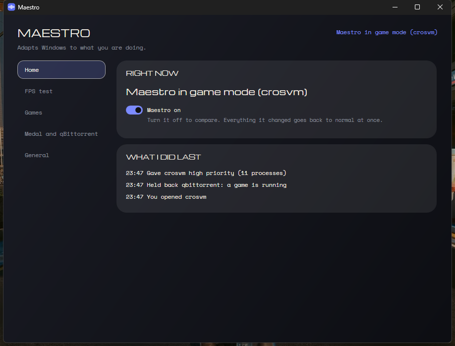
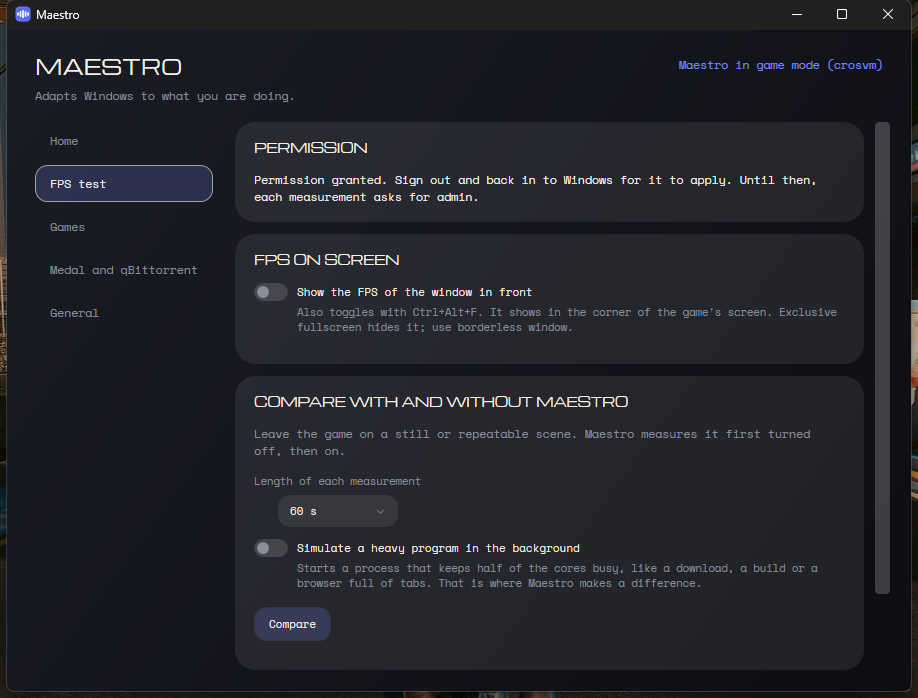

<div align="center">


# Maestro

**O Windows ajustado ao que você está fazendo, com o FPS para provar.**<br>
Um app de bandeja que dá prioridade ao jogo na frente, segura o que pesa no processador por trás e mede seu FPS com e sem ele, para você ver a diferença em vez de acreditar nela.

[](https://github.com/obrenoalvim/maestro/releases/latest/download/Maestro.exe)

[](LICENSE)
[](https://github.com/obrenoalvim/maestro/stargazers)
[](https://github.com/obrenoalvim/maestro/releases/latest)
[](src/Maestro/Maestro.csproj)
[](#perguntas)

[English](README.md) · **Português**

[Instalar](#instalar) · [O que ele faz](#o-que-ele-faz) · [Teste de FPS](#teste-de-fps) · [Como ele reconhece um jogo](#como-ele-reconhece-um-jogo) · [O que ele nunca toca](#o-que-ele-nunca-toca) · [Configuração](#configuração) · [Perguntas](#perguntas) · [Compilar](#compilar)

</div>

---



O Maestro fica perto do relógio olhando o que você está fazendo. Abriu um jogo, ele dá prioridade alta ao jogo, freia os torrents e abre o Medal para gravar. Deixou algo pesado rodando em segundo plano, ele tira isso do caminho e solta na hora em que você clica na janela dele. Fechou o jogo, tudo volta a ser como era. Não precisa de administrador e não manda nada para lugar nenhum.

## Instalar

1. **Baixe** o [`Maestro.exe`](https://github.com/obrenoalvim/maestro/releases/latest/download/Maestro.exe). É um arquivo só, com tudo dentro, então não precisa instalar .NET. Windows 10 versão 2004 ou mais novo.
2. **Clique duas vezes.** Se o Windows mostrar a tela azul "O Windows protegeu o computador", clique em **Mais informações** e depois em **Executar assim mesmo**. Essa tela aparece porque o arquivo ainda não tem assinatura digital.
3. **A janela abre** e um ícone aparece perto do relógio. A partir daí o Maestro inicia com o Windows e entra no menu Iniciar. Desligue a inicialização na página **Geral**.

Para remover: escolha **Sair** no menu da bandeja e apague o `Maestro.exe` e as pastas `%APPDATA%\Maestro` e `%LOCALAPPDATA%\Maestro`.

## O que ele faz

**Quando você abre um jogo**
- O jogo ganha prioridade alta.
- Os torrents (o que estiver em `SlowDuringGames`) são segurados, e o limite alternativo de velocidade do qBittorrent liga se a Interface Web dele estiver ligada.
- O Medal abre escondido para gravar.

**Quando o jogo fecha**, tudo isso é desfeito. O Medal fecha alguns minutos depois, a não ser que você esteja usando a janela dele.

**O tempo todo**
- Um programa em segundo plano que passa de 15% do processador por 6 segundos (8% com jogo aberto) vai para prioridade abaixo do normal, modo eficiência e disco em prioridade baixa. Em processadores híbridos, isso o leva para os núcleos E.
- Ele volta ao normal quando acalma, ou na hora em que você traz a janela dele para a frente.
- Um programa lendo ou gravando mais de 20 MB/s (uma cópia, uma instalação, um download indo para o disco) ganha prioridade acima do normal enquanto não houver jogo aberto.

Toda mudança é anotada num diário antes. Pausar, sair ou abrir de novo depois de uma queda devolve cada processo ao que era.

## Teste de FPS



- **FPS na tela.** Ligue no app, no menu da bandeja ou com `Ctrl+Alt+F`. Ele mostra o FPS e o 1% mais baixo da janela da frente, no canto da tela dela.
- **Comparar com e sem o Maestro.** Deixe o jogo numa cena parada ou repetível e clique em **Comparar**. O Maestro mede desligado, depois ligado, e mostra lado a lado o FPS médio, o 1% mais baixo e o pior tempo de quadro. As comparações anteriores ficam listadas.
- **Simular um programa pesado.** É com carga em segundo plano que o Maestro ajuda, então essa opção abre um processo que ocupa metade dos núcleos durante as duas medições, como uma compilação ou um navegador cheio de abas.

Sem nada pesado em segundo plano a diferença é pequena, porque o Windows já favorece a janela da frente. Ela aparece no 1% mais baixo quando algo disputa o processador. Diferenças abaixo de 2% são a variação normal entre duas medições.

Os quadros são lidos pelo [PresentMon](https://github.com/GameTechDev/PresentMon), o medidor open source da Intel, baixado da release oficial no primeiro uso e conferido por SHA-256. O Windows só deixa um app ler os quadros de outro programa com administrador ou com a conta no grupo **Usuários de log de desempenho**, então na primeira vez o Maestro oferece **Permitir uma vez**: um pedido de administrador, depois sair e entrar na conta, e ele não pede mais. Até lá, cada medição pede administrador.

## Como ele reconhece um jogo

Não existe lista de jogos para manter. O Maestro segue o Windows:
- o processo `GameBarPresenceWriter`, que a Game Bar roda enquanto há jogo;
- os jogos que o Windows já viu, em `HKCU\System\GameConfigStore`;
- os que você marcou à mão na Game Bar (`Win+G`, "Lembrar que isto é um jogo");
- o que você puser em `ExtraGames`.

## O que ele nunca toca

A janela da frente, processos do sistema, áudio, anticheats conhecidos e a lista `NeverRestrain` (Explorer, Discord, OBS, Medal e algumas ferramentas de mouse e teclado, por padrão). Se o Windows recusa uma mudança, o Maestro deixa aquele processo em paz.

## Configuração

Tudo está nas páginas da janela e é salvo em `%APPDATA%\Maestro\maestro.json`, que recarrega quando você salva à mão. Se o arquivo tiver um erro, o Maestro continua com a última versão que funcionava e avisa no menu da bandeja.

| Chave | Para quê |
| --- | --- |
| `ExtraGames` | nomes de processo que contam como jogo mesmo sem o Windows saber |
| `NeverRestrain` | processos que ele nunca segura |
| `SlowDuringGames` | processos segurados enquanto houver jogo |
| `Medal` | `Manage`, `Path` e `CloseAfterMinutes` |
| `QBittorrentWebUi` | endereço da Interface Web do qBittorrent, só `127.0.0.1` |
| `Language` | `auto`, `en` ou `pt` |
| `CheckUpdates` | perguntar ao GitHub por versão nova a cada poucas horas |
| `ShowFps` | contador de FPS ligado ao iniciar |

O histórico do que ele fez fica em `%LOCALAPPDATA%\Maestro\logs`, por sete dias.

## Perguntas

**Precisa de administrador?** Não. O único pedido de administrador é a permissão opcional, uma vez só, para o medidor de FPS.

**Um anticheat vai reclamar?** O Maestro muda prioridade pelas mesmas chamadas do Windows que o Gerenciador de Tarefas usa. Se o processo de um jogo recusar, ele desiste daquele processo. Os serviços de anticheat estão na lista de nunca tocar.

**O contador aparece em tela cheia exclusiva?** Não, a tela cheia exclusiva desenha por cima de qualquer janela. Use o modo janela sem borda. A comparação continua medindo em tela cheia exclusiva.

**Como desfaço tudo?** Desligue **Maestro ligado** na página Início, escolha **Pausar** no menu da bandeja ou saia. Tudo o que ele mudou volta na hora.

**Ele manda dados para algum lugar?** Sem telemetria. Ele só acessa a internet para baixar o PresentMon quando você liga o medidor de FPS e, se você deixar a opção ligada, para perguntar ao GitHub se saiu versão nova. Nunca baixa nem instala atualização sozinho.

**Qual a diferença para o Process Lasso?** O Maestro é gratuito e open source, sabe quando você está jogando sem precisar de lista, cuida do Medal e do qBittorrent e mede o resultado em vez de pedir para você confiar.

## Compilar

Precisa do .NET 10 SDK.

```powershell
dotnet test
dotnet publish src/Maestro/Maestro.csproj -c Release -r win-x64 --self-contained true -p:PublishSingleFile=true -p:EnableCompressionInSingleFile=true -p:IncludeNativeLibrariesForSelfExtract=true -o publish
```

`Maestro.exe --sair` fecha uma instância aberta do jeito certo, o que ajuda na hora de trocar o arquivo.

## Créditos

Ideias do [GameModeExecutor](https://github.com/Geeooff/GameModeExecutor) (MIT), [GameShift](https://github.com/lhceist41/GameShift) (MIT), [Process Governor](https://github.com/SystemXFiles/process-governor) (GPL), [AutoActions](https://github.com/Codectory/AutoActions) (GPL) e [Hook](https://github.com/spddl/Hook). Nenhum código deles foi copiado. Os dados de FPS vêm do [PresentMon](https://github.com/GameTechDev/PresentMon) (MIT), baixado na hora de usar. A interface usa as fontes Michroma e Space Mono (SIL Open Font License).

## Licença

[MIT](LICENSE)
